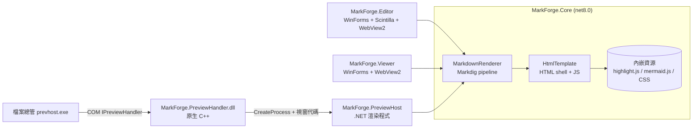
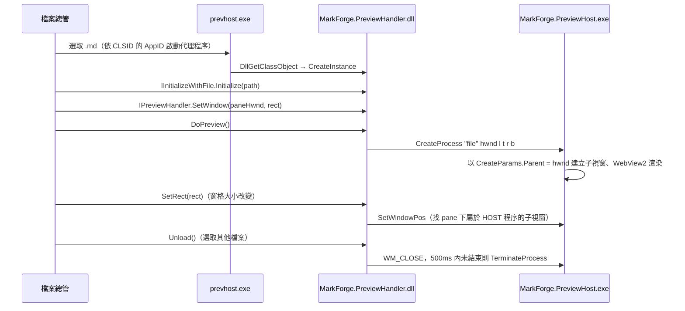

# MarkForge 技術說明書

適用版本：**v1.7.0**

這份文件寫給維護者和開發者，說明 MarkForge 的架構、各模組的運作方式與設計理由、檔案總管預覽處理常式的註冊方式，以及建置、發布與測試流程。
操作方式請見 [使用說明書](使用說明書.md)，版本歷程見 [versions.md](../versions.md)。

---

## 目錄

1. [系統概觀](#1-系統概觀)
2. [專案結構](#2-專案結構)
3. [Markdown 渲染管線（MarkForge.Core）](#3-markdown-渲染管線markforgecore)
4. [MarkForge Editor](#4-markforge-editor)
5. [貼上與拖入轉換（Import）](#5-貼上與拖入轉換import)
6. [附件管理（DocumentAssets）](#6-附件管理documentassets)
7. [MarkForge Viewer](#7-markforge-viewer)
8. [檔案總管預覽處理常式](#8-檔案總管預覽處理常式)
9. [執行期檔案與資料夾](#9-執行期檔案與資料夾)
10. [建置、發布與打包](#10-建置發布與打包)
11. [版本控制流程](#11-版本控制流程)
12. [測試方式](#12-測試方式)
13. [已知限制與後續方向](#13-已知限制與後續方向)

---

## 1. 系統概觀



| 元件 | 類型 | 目標框架 | 主要相依 |
|------|------|---------|---------|
| MarkForge.Core | 類別庫 | net8.0 | Markdig 1.3.2 |
| MarkForge.Editor | WinExe | net8.0-windows | WebView2、Scintilla.NET 5.3.2.9、Svg 3.4.8、HtmlAgilityPack 1.13.0、ExcelDataReader 3.9.0 |
| MarkForge.Viewer | WinExe | net8.0-windows | WebView2 |
| MarkForge.PreviewHost | WinExe | net8.0-windows | WebView2 |
| MarkForge.PreviewHandler | 原生 DLL（x64） | C++17、v143 工具組 | Windows SDK（shlwapi）；靜態 CRT |

三支 .NET 程式都以 framework-dependent、win-x64 發布，執行時需要 .NET 8 Desktop Runtime 與 WebView2 Runtime。

---

## 2. 專案結構

```
MarkForge_v1.1/
├── MarkForge.slnx                      # Editor / Viewer / PreviewHost（C++ 專案不在方案內，另以 MSBuild 建置）
├── MarkForge.Core/
│   ├── MarkdownRenderer.cs             # Markdig pipeline、RenderBody / RenderDocument / RenderStandaloneDocument
│   ├── HtmlTemplate.cs                 # HTML 外殼、CSS、LiveScript／StaticHighlightScript／PanZoomScript／
│   │                                   #   ScrollSyncScript／DocImageScript、資源解壓縮
│   ├── MermaidExtension.cs             # ```mermaid → <pre class="mermaid">，並為程式碼區塊標上原始碼行號
│   ├── SourceSyncExtension.cs          # 為標題標上原始碼行號（同步捲動錨點）
│   └── Assets/                         # highlight.min.js、mermaid.min.js、github(-dark).min.css（內嵌資源）
├── MarkForge.Editor/
│   ├── Program.cs
│   ├── MainForm.cs                     # 版面、WebView2 初始化、文件圖片服務、主題切換、同步捲動
│   ├── MainForm.Ui.cs                  # 選單、工具列、右鍵選單、預覽寬度選單
│   ├── MainForm.Formatting.cs          # Scintilla 設定、語法配色、格式指令、自動接續清單
│   ├── MainForm.FileIO.cs              # 新增／開啟／儲存（含附件複製）／匯出、視窗層級拖放
│   ├── MainForm.Import.cs              # 智慧貼上、編輯區拖放（接管 Scintilla 的 OLE drop target）
│   ├── DocumentAssets.cs               # 尚未存檔的圖片／附件、存檔時複製、預覽解析
│   ├── Import/
│   │   ├── HtmlToMarkdown.cs           # 剪貼簿 HTML → Markdown；ClipboardHtml（CF_HTML 解析、來源判斷）
│   │   ├── MarkdownTable.cs            # 格狀資料 → GFM 表格；CSV/TSV 解析
│   │   └── SpreadsheetReader.cs        # .xlsx/.xls（ExcelDataReader）、.ods（content.xml）、.csv/.tsv
│   ├── UiTheme.cs                      # 深色／淺色外框主題（Viewer 以連結方式共用）
│   ├── IconProvider.cs                 # Bootstrap Icons SVG → Bitmap，支援主題換色
│   ├── WidthPromptDialog.cs
│   └── Assets/Icons/*.svg
├── MarkForge.Viewer/
│   ├── ViewerForm.cs                   # 檢視、FileSystemWatcher 自動重新載入
│   └── WidthPromptDialog.cs
├── MarkForge.PreviewHandler/           # 原生 C++
│   ├── PreviewHandler.cpp              # COM 類別、Class Factory、DllRegisterServer
│   ├── PreviewHandler.def              # 匯出 DllGetClassObject / DllCanUnloadNow / DllRegisterServer / DllUnregisterServer
│   └── MarkForge.PreviewHandler.vcxproj
├── MarkForge.PreviewHost/
│   ├── Program.cs                      # 命令列解析、錯誤記錄
│   └── PreviewSurface.cs               # 建立於預覽窗格內的子視窗 + WebView2
├── installer.iss                       # Inno Setup 6 腳本
├── docs/                               # 使用說明書、技術說明書
├── versions.md                         # 版本說明
└── README.md
```

---

## 3. Markdown 渲染管線（MarkForge.Core）

### 3.1 Markdig pipeline

`MarkdownRenderer` 使用單一靜態 pipeline：

| 擴充 | 作用 |
|------|------|
| `UseAdvancedExtensions()` | GFM 表格、任務清單、刪除線、自動連結、註腳、定義清單等 |
| `UseEmojiAndSmiley()` | `:smile:` 等 emoji |
| `UseSoftlineBreakAsHardlineBreak()` | 單一換行即換行（貼近一般使用者直覺，也讓 Word 貼上的段內換行保留） |
| `MermaidExtension` | 取代預設 `CodeBlockRenderer`：` ```mermaid ` 輸出 `<pre class="mermaid">`；所有程式碼區塊加上 `data-src-line`／`data-src-end` |
| `SourceSyncExtension` | 標題加上 `data-src-line` |

輸出的三個進入點：

| 方法 | 用途 | 資源載入方式 |
|------|------|-------------|
| `RenderBody()` | 只產生 HTML 片段，Editor 即時預覽以 `updateContent()` 注入 | — |
| `RenderDocument()` | 完整頁面，Viewer／PreviewHost 以 `NavigateToString` 顯示 | 虛擬主機 `https://markforge.assets/` |
| `RenderStandaloneDocument()` | 「匯出為 HTML」寫入檔案 | CSS／JS 全部內嵌 |

### 3.2 為什麼用虛擬主機載入資源

WebView2 的 `NavigateToString` 有 **2 MB** 上限，`mermaid.min.js` 就有 3.57 MB。因此資源在執行期解壓縮到 `%TEMP%\MarkForge\<App>\WebAssets`，以 `SetVirtualHostNameToFolderMapping("markforge.assets", …)` 對應，頁面用 `<script src="https://markforge.assets/…">` 載入（v1.0.1）。匯出 HTML 則必須內嵌，因為虛擬主機只在 App 內有效（v1.4.1、v1.5.0）。

`EnsureAssetsExtracted()` 以「檔案存在且大小相同就略過」判斷是否需要重寫；寫入時先寫 `*.{pid}.tmp` 再 `File.Move(overwrite)`，避免多個預覽程式同時啟動時搶寫同一個檔案（v1.7.0）。

### 3.3 文件相對路徑圖片：`markforge.doc`

`NavigateToString` 載入的頁面沒有 base URL，`` 無法解析。`DocImageScript`（`mfResolveImages()`）在內容更新與 `DOMContentLoaded` 時改寫 `#content` 內的 `img`／`video`／`source`：

| 原始 `src` | 改寫為 |
|-----------|-------|
| 相對路徑 `photo.png`、`./img/a.png` | `https://markforge.doc/photo.png` |
| Windows 絕對路徑 `C:\pics\a.png`、`file:///C:/pics/a.png` | `https://markforge.doc/__abs__/C:/pics/a.png` |
| `http(s):`、`data:`、以 `/` 或 `#` 開頭 | 不改寫 |

各程式如何提供 `markforge.doc`：

| 程式 | 方式 |
|------|------|
| Editor | `WebResourceRequested` 攔截，由 `DocumentAssets.Resolve()` 找檔：先找尚未存檔的附件，再找 `.md` 資料夾；`__abs__/` 直接讀絕對路徑 |
| Viewer、PreviewHost | `SetVirtualHostNameToFolderMapping("markforge.doc", .md 所在資料夾)` |

匯出 HTML（`inline == true`）不注入此腳本，相對路徑保持原樣，HTML 放在 `.md` 旁邊即可正確顯示。

### 3.4 頁面腳本

| 腳本 | 功能 |
|------|------|
| `LiveScript` | Editor 用：`updateContent(html)` 替換內容 → 改寫圖片 → highlight.js → `mermaid.run()`（async，PDF 匯出會等圖畫完） |
| `StaticHighlightScript` | Viewer／PreviewHost／匯出用：載入後上色並渲染 Mermaid |
| `PanZoomScript` | 每張 Mermaid 圖獨立縮放（滾輪，0.2～12 倍，以游標為中心）、拖曳平移、按兩下重設 |
| `ScrollSyncScript` | 以 `data-src-line` 建立「原始碼行號 ↔ 像素位置」錨點表，雙向換算捲動位置；透過 `chrome.webview.postMessage` 回傳行號給 Editor |
| `DocImageScript` | 見 3.3 |

CSS 以 `html[data-theme="dark"]` 切換深色；`overflow-anchor: none` 停用 Chromium 捲動錨定，避免與同步捲動互相干擾（v1.4.0）。

---

## 4. MarkForge Editor

### 4.1 即時預覽

- 編輯區 `Insert`／`Delete` 事件 → 250ms 防抖動計時器 → `RenderBody()` → `ExecuteScriptAsync("updateContent(...)")`。
- 主題、預覽字型、預覽寬度改變時重新 `NavigateToString(HtmlTemplate.Shell(...))`，`NavigationCompleted` 後再推一次內容。

### 4.2 同步捲動

- 編輯區 → 預覽：Scintilla `UpdateUI`（`VScroll`）時送出第一個可見的文件行號，由頁面依錨點表內插。
- 預覽 → 編輯區：頁面捲動時回傳行號，設定 `FirstVisibleLine`，期間以 `_suppressEditorScrollSync` 防止迴圈。
- **安定視窗**：開檔後 Scintilla 背景換行與上色會產生假的捲動事件；`BeginScrollSyncSettleWindow()` 讓同步暫停，直到捲動事件停止 400ms 才恢復（v1.4.0）。

### 4.3 主題（UiTheme、IconProvider）

- `_darkTheme` 預設 `true`（v1.6.0）。
- `UiTheme.ApplyToolStrip()`：深色時使用自訂 `ProfessionalColorTable` 與 renderer（文字、箭頭、核取記號改淺色），淺色時還原系統預設。
- `UiTheme.ApplyTitleBar()`：`DwmSetWindowAttribute(DWMWA_USE_IMMERSIVE_DARK_MODE = 20，舊版 19)`。
- `UiTheme.ApplyScrollbars()`：`SetWindowTheme(hwnd, "DarkMode_Explorer")` 讓 Scintilla 原生捲軸變深色。
- `IconProvider` 以 `ConditionalWeakTable<Image, IconSpec>` 記錄每張圖示的名稱／大小／顏色；切換主題時 `Recolor()` 只重繪「原本是舊圖示色」的項目，工作清單的彩色圖示不受影響。
- `UiTheme.cs` 同時被 Viewer 以 `<Compile Include="..\MarkForge.Editor\UiTheme.cs" Link="UiTheme.cs" />` 共用。

### 4.4 編輯區拖放：接管 Scintilla 的 OLE drop target

Scintilla 在建立視窗時自行 `RegisterDragDrop`，它的 drop target 只接受文字，檔案拖進來會被拒絕。`TakeOverEditorDropTarget()`：

1. `AllowDrop = false` → `RevokeDragDrop(hwnd)` → `AllowDrop = true`，改由 WinForms 註冊 drop target。
2. 必須在 Scintilla 視窗建立後執行。`ApplyEditorAppearance()` 在建構子中就會觸發視窗建立，所以除了 `HandleCreated` 事件外，建構子也要在 `IsHandleCreated` 時立即呼叫（v1.6.0 開發時發現：只掛事件會錯過，導致拖放落到表單層、插在游標處而非放開處）。

接管後自行實作文字拖曳：

| 拖曳來源 | 判斷 | 處理 |
|---------|------|------|
| 編輯區內的選取文字 | `DragEnter` 時資料文字等於目前選取且允許 Move | `MoveSelectionTo()`：放開處在選取範圍之後時先插入再刪除，之前時先刪除再插入；**回報 `DragDropEffects.Copy`**——Scintilla 是拖曳來源，收到 Move 會自己再刪一次選取範圍 |
| 外部文字／HTML | — | 走 `InsertFromDataObject()`（同貼上） |
| 檔案 | `.md` 單一檔案 | 開啟 |
| 檔案 | 其他 | `InsertFiles()`，插入在 `CharPositionFromPoint()` 位置 |

預覽區的 WebView2 設定 `AllowExternalDrop = false`，否則拖入的檔案會讓 WebView2 直接瀏覽該檔案、取代預覽頁面。

### 4.5 貼上的攔截點

| 入口 | 處理 |
|------|------|
| `Ctrl+V`（選單快捷鍵，先於 Scintilla 處理） | `SmartPaste()` |
| `Shift+Insert` | `ProcessCmdKey` 攔截 → `SmartPaste()` |
| 右鍵選單 | `UsePopup(false)` 停用 Scintilla 內建選單，改用自訂 `ContextMenuStrip` |
| `Ctrl+Shift+V` | `PastePlainText()` |

---

## 5. 貼上與拖入轉換（Import）

### 5.1 `InsertFromDataObject()` 判斷順序

Excel 與 Word 複製時都會**同時**放一張點陣圖到剪貼簿，因此文字類格式必須先於圖片判斷：

1. **FileDrop**（檔案總管複製的檔案）→ `InsertFiles()`
2. 有 `XML Spreadsheet` 或 `Csv` 格式（Excel／Calc）→ 以 Unicode 文字（Tab 分隔）轉表格
3. 有 `HTML Format`，且 `IsFromDocumentApp()` 或 `HasMarkdownWorthyStructure()` → `HtmlToMarkdown.Convert()`
4. 純文字且 `LooksLikeTsv()` → 表格
5. 純文字 → 拖放時插入；貼上時回傳 false 交給 Scintilla 原生貼上
6. `PNG` 串流（保留透明）或 `Bitmap` → 暫存為 PNG 圖片

`HasMarkdownWorthyStructure()` 遇到 `white-space: pre`（VS Code 等程式碼編輯器的上色 HTML）一律回傳 false。

### 5.2 CF_HTML 解析（`ClipboardHtml.Extract`）

CF_HTML 標頭（`Version`／`StartHTML`／`EndHTML`／`StartFragment`／`EndFragment`／`SourceURL`）的位移是 **UTF-8 位元組**位移，但 Word 會把 `<head>` 內的 CSS 字型名稱以 ANSI 字碼頁寫入。字串解碼後位移對不上，`EndHTML` 超出範圍時會退回只取 fragment，**樣式表因此被截掉**，Word「標題」（MsoTitle）與內文的字級全部遺失。

現行做法：完全不使用位移，直接取標頭後第一個以 `<` 開頭的行到結尾。

### 5.3 HtmlToMarkdown 演算法

**前處理（字串層級）**

| 處理 | 原因 |
|------|------|
| `<![if !supportLists]>…<![endif]>` → `<mf-listmarker data-m="1.">` | Word 把清單符號寫成實際文字；保留下來判斷有序／無序 |
| 移除其餘 `<![if …]>`／`<![endif]>` | 下層級條件註解 |
| 以正規式從**原始字串**擷取所有 `<style>` 內容 | Word 剪貼簿的樣式表位於 `<!--[if gte mso 10]>…<![endif]-->` 條件註解內，HTML 解析器看不到 `<style>` 元素 |

**樣式解析**：只收 `tag.class` 與 `.class` 選擇器（Word 的 `p.MsoTitle`、`p.MsoNormal` 等），去除註解與 `@font-face`／`@page`／`@list` 規則。每個元素的樣式依序套用：標籤語意（`b`、`em`、`s`、`code`、`th`、`font size`）→ class 規則 → `style` 屬性。

| CSS | 解讀 |
|-----|------|
| `font-size` | `pt`、`px`（×0.75）、`em`／`rem`／`%`（相對父層），四捨五入到 0.5pt |
| `font-weight` | `bold`／`bolder`／≥600 為粗體；`normal`／`400` 取消（Google 文件外層的 `<b style="font-weight:normal">`） |
| `font-style` | `italic`／`oblique` |
| `text-decoration(-line)` | 含 `line-through` 為刪除線 |

**區塊走訪**：`WalkBlocks()` 把 DOM 轉成區塊串列（段落、標題、Word 清單項、原始 Markdown）。

- 行內元素若包含區塊元素（Google 文件整份包在 `<b>` 裡），視為透明容器繼續走訪。
- 段落、標題、清單、表格、引用、程式碼、分隔線各自處理；清單項目、引用、表格儲存格以巢狀轉換器（`_nested`）轉換，不做字級標題判斷。
- 每個段落記錄「各字級的可見字元數」，取最多字元的字級為該段落的 `DominantSize`。
- Word 清單段落：`mso-list:l{id} level{n}` 決定層級，清單 id 改變時重新編號；符號符合 `1.`、`a)`、`(一)`、`一、` 等為有序清單。

**字級標題判斷**（`PromoteSizedParagraphs()`）：

1. 統計所有段落的字級直方圖（依字元數加權），沒有字級的段落算在 `-1`。
2. 內文字級 = 字元數最多的字級；若最多的是 `-1`（例如 LibreOffice 內文使用樣式預設值），或只有一種字級，內文取 **12pt**。
3. 條件：段落 ≤ 120 字、單行、不是圖片。
4. 比例 ≥1.75 → `#`、≥1.45 → `##`、≥1.25 → `###`、≥1.12 → `####`；轉為標題時移除 `**`。

**輸出細節**

| 項目 | 處理 |
|------|------|
| 空白 | HTML 空白摺疊；**CJK 字元之間的原始碼換行直接移除**（Word 會在中文字中間斷行，否則會多出空格） |
| 跳脫 | `*`、`` ` ``、`[`、`]`、字詞邊界的 `_`、看起來像標籤的 `<`；行首的 `#`、`>`、`-`、`+`、`1.` 等 |
| 相鄰粗體 | `**a****b**` 合併為 `**ab**`（Word 常把一段粗體拆成多個 run） |
| 強調跨換行 | 每行各自包覆 |
| 圖片 | `resolveImage` 回呼：`file:///`（Word 的 `msohtmlclip` 暫存檔）與 `data:image/…;base64` 暫存為附件，網址保持不變 |
| 清單間距 | 同一個 Word 清單的項目之間不空行；清單項內的子清單緊接項目文字（避免變成 loose list） |

### 5.4 表格（MarkdownTable）

- `ParseDelimited()`：RFC 4180 引號規則（`""` 跳脫、引號內可換行）。
- `Normalize()`：去除前後空白列、右側空白欄，補齊欄數。
- 欄寬以 `DisplayWidth()` 計算：東亞寬字元（CJK、全形、韓文等區段）算 2 格。
- 整欄（不含表頭）皆為數字（可含 `,`、`%`、`$`）時靠右對齊。
- `LooksLikeTsv()`：≥2 行、每行 Tab 數相同且 >0、行首不是 Tab、不含引號。

### 5.5 SpreadsheetReader

| 格式 | 實作 |
|------|------|
| `.xlsx`／`.xlsm`／`.xls` | ExcelDataReader，`FileShare.ReadWrite` 開啟（Excel 開著也能讀）；啟動時註冊 `CodePagesEncodingProvider` 以支援 `.xls` 的 ANSI 字串 |
| `.ods` | 解壓 `content.xml`，讀 `table:table-row`／`table:table-cell`／`text:p`；`number-columns-repeated`／`number-rows-repeated` 只在有內容時展開（上限 1000） |
| `.csv`／`.tsv` | 先以嚴格 UTF-8 解碼，失敗改用系統 ANSI 字碼頁（繁中 Windows 為 Big5）；`GuessDelimiter()` 依第一行 `,`／Tab／`;` 出現次數判斷 |

儲存格格式：日期 `yyyy-MM-dd`（含時間 `yyyy-MM-dd HH:mm`）、數字不變文化格式、布林 `TRUE`／`FALSE`。

---

## 6. 附件管理（DocumentAssets）

### 6.1 資料結構

- `_pending`：`相對檔名 → 目前實際位置`（不分大小寫）。拖入的檔案指向原檔；剪貼簿圖片與 Word 暫存圖片先複製到暫存資料夾 `%TEMP%\MarkForge\Editor\Staging\<12 碼隨機>\`。
- `DocumentDirectory`：目前 `.md` 所在資料夾；未存檔時為 null。
- 新增、開啟文件時 `Reset()`；Editor 關閉時 `Dispose()` 刪除暫存資料夾。

### 6.2 命名（`AddFile`）

1. 檔案在 `DocumentDirectory` 之內 → 直接回傳相對路徑，不列入 pending。
2. 依序嘗試 `name.ext`、`name-2.ext`、`name-3.ext`…：
   - pending 中已有同名：同一來源或內容相同就共用，否則換下一個名稱。
   - 文件資料夾已有同名檔：內容相同就直接引用（不列入 pending），否則換下一個名稱。
3. 剪貼簿圖片命名 `image-yyyyMMdd-HHmmss-序號.png`。

### 6.3 存檔（`CommitForSave`）

1. 以正規式找出 Markdown 中所有連結目的地：``、`[..](..)`（含 `<…>` 形式），以及 HTML 的 `img`／`source`／`video`／`audio` `src`。
2. 只處理相對路徑；去掉 `#`、`?` 之後的部分並做 URL 解碼。
3. 來源：pending 優先；若是另存到**不同資料夾**，舊資料夾中存在的檔案也算。
4. 目的地已有**不同內容**的同名檔 → 改名 `-2`、`-3`…並記錄改名；相同內容或同一路徑就略過。
5. 改名後以正規式替換 Markdown 中的連結（左側為 `(`、`<`、`"`、`'`，右側為 `)`、`>`、`"`、`'` 或空白）。Editor 以 `ReplaceTarget` 整段替換，保留游標與捲動位置，並可一次復原。
6. 失敗項目收集後於存檔完成時提示，不中斷存檔。

檔案比對：大小不同即不同；64 MB 以下逐位元組比較，更大的檔案比較修改時間。

---

## 7. MarkForge Viewer

- 開啟檔案時建立 `FileSystemWatcher`（`LastWrite | Size`），變更後以 200ms 防抖動重新 `NavigateToString(RenderDocument(...))`；讀檔遇到 `IOException`（對方寫入中）直接略過，等下一次事件。
- 每次渲染前確認 `markforge.doc` 對應到目前檔案的資料夾（資料夾改變時先 `Clear…Mapping` 再重新對應）。
- `AllowExternalDrop = false`，拖放由表單處理（開啟檔案）。

---

## 8. 檔案總管預覽處理常式

### 8.1 架構與設計理由



**為什麼是 C++ DLL + 獨立 .NET 程序**：預覽處理常式會被載入共用的 `prevhost.exe`。若直接用 .NET 撰寫 COM DLL，.NET 執行階段會進入該程序，而一個程序只能載入一個版本的 .NET；與其他以 .NET 撰寫的預覽處理常式（例如舊版 PowerToys）共存時可能衝突。C++ DLL 只處理 COM 介面，渲染在獨立程序中執行，崩潰也不會影響檔案總管。

### 8.2 C++ DLL（PreviewHandler.cpp）

| 介面 | 實作 |
|------|------|
| `IInitializeWithFile` | 記錄檔案路徑 |
| `IPreviewHandler` | `SetWindow`／`SetRect` 記錄並調整子視窗；`DoPreview` 啟動 PreviewHost（從 DLL 所在資料夾找 `MarkForge.PreviewHost.exe`）；`Unload` 關閉；`TranslateAccelerator` 轉交 `IPreviewHandlerFrame` |
| `IOleWindow` | 回傳預覽窗格視窗 |
| `IObjectWithSite` | 保存 site（供 `IPreviewHandlerFrame` 查詢） |
| `IPreviewHandlerVisuals` | 接受但不使用；配色依 Windows 應用程式模式 |

- CLSID：`{05E77F8A-F696-4E53-87D1-B4DA1DCA49D6}`
- 命令列：`MarkForge.PreviewHost.exe "<檔案>" <父視窗代碼> <left> <top> <right> <bottom>`
- 靜態 CRT（`/MT`）、`/utf-8`、Level 4 警告、SDL 檢查。
- `DllRegisterServer`／`DllUnregisterServer` 寫入與安裝程式相同的 HKLM 機碼，需在系統管理員命令提示字元執行 `regsvr32`；完成後呼叫 `SHChangeNotify(SHCNE_ASSOCCHANGED)`。解除註冊時，只有 `.md` 的預覽處理常式仍是 MarkForge 時才刪除。

### 8.3 .NET 渲染程式（PreviewHost）

- **子視窗建立方式**：`PreviewSurface : ContainerControl`，覆寫 `CreateParams`（`Parent = 預覽窗格`、`WS_CHILD | WS_VISIBLE | WS_CLIPCHILDREN | WS_CLIPSIBLINGS`），以 `Application.Run(new ApplicationContext())` 執行訊息迴圈。
  - 開發時驗證：以 `Form` 建立後 `SetParent` + 修改樣式的做法**不可行**，WinForms 顯示時重建視窗代碼，新視窗是隱藏的頂層視窗。
- **結束**：收到 `WM_CLOSE` 立即 `Environment.Exit(0)`（約 20ms；正常釋放 WebView2 會超過 DLL 的 500ms 等待）。每秒檢查父視窗是否仍存在，檔案總管異常結束時自行離開。WebView2 子程序在宿主結束後自動結束。
- **主題**：讀取 `HKCU\Software\Microsoft\Windows\CurrentVersion\Themes\Personalize\AppsUseLightTheme`。
- **安全性**：

  | 措施 | 實作 |
  |------|------|
  | 禁止網路資源 | `AddWebResourceRequestedFilter("*")`，只放行 `data:`、`blob:`、`about:` 與 `https://markforge.assets`／`https://markforge.doc`，其餘回應 403 |
  | 禁止頁面跳轉 | `NavigationStarting`：只允許自己發出的那一次 `NavigateToString`，其餘取消；`http`／`https`／`mailto` 交給預設瀏覽器 |
  | 新視窗 | `NewWindowRequested` 一律攔截，同上處理 |
  | 其他 | 停用開發者工具、瀏覽器快捷鍵、狀態列、縮放、自動填入 |

- 檔案 > 8 MB 顯示提示；讀檔使用 `FileShare.ReadWrite | FileShare.Delete`。
- 所有未處理例外與 WebView2 初始化失敗寫入 `%LOCALAPPDATA%\MarkForge\PreviewHost\error.log`（超過 256 KB 自動清空），不跳出任何對話框。

### 8.4 登錄機碼

安裝程式在工作「previewpane」勾選時寫入（`HKCR` 在系統管理員安裝時即 `HKLM\Software\Classes`）：

| 機碼 | 值 |
|------|----|
| `HKCR\CLSID\{05E77F8A-…}` | 預設值 `MarkForge Markdown Preview Handler`；`DisplayName`；`AppID = {6d2b5079-2f0b-48dd-ab7f-97cec514d30b}`（64 位元 prevhost 代理）；`DisableLowILProcessIsolation = 1` |
| `HKCR\CLSID\{05E77F8A-…}\InprocServer32` | 預設值 `{app}\PreviewHandler\MarkForge.PreviewHandler.dll`；`ThreadingModel = Apartment` |
| `HKCR\.md\ShellEx\{8895b1c6-b41f-4c1c-a562-0d564250836f}` | `{05E77F8A-…}` |
| `HKCR\.markdown\ShellEx\{8895b1c6-…}` | `{05E77F8A-…}` |
| `HKLM\SOFTWARE\Microsoft\Windows\CurrentVersion\PreviewHandlers` | 值名稱 `{05E77F8A-…}` = `MarkForge Markdown Preview Handler` |

**必須註冊在 HKLM**：開發時以 `regsvr32` 註冊在 HKCU 測試，檔案總管只顯示「沒有預覽可用」。以 `CoCreateInstance(CLSCTX_LOCAL_SERVER)` 驗證，HKCU 的類別（即使 AppID 也放在 HKCU）一律回傳 `REGDB_E_CLASSNOTREG`：COM 不會在代理程序中啟用只在 HKCU 註冊的類別。

**`DisableLowILProcessIsolation = 1`**：預設 prevhost 以低完整性等級執行，WebView2 無法在低完整性程序中運作，且子程序會繼承完整性等級。

### 8.5 安裝程式的配合

- `ChangesAssociations=yes`：安裝／解除安裝結束時通知檔案總管重新讀取關聯。
- `PrepareToInstall`：安裝前 `taskkill` 結束 `MarkForge.PreviewHost.exe` 與 `prevhost.exe`，避免 DLL 被鎖住（檔案總管下次預覽時會自動重啟 prevhost）。
- `[UninstallRun]`：解除安裝前同樣結束這兩個程序。
- DLL 檔案旗標 `restartreplace uninsrestartdelete`：萬一仍被鎖住，重新開機後替換／刪除。

---

## 9. 執行期檔案與資料夾

| 路徑 | 內容 | 建立者 |
|------|------|-------|
| `{app}\Editor\`、`{app}\Viewer\`、`{app}\PreviewHandler\` | 程式檔（預設 `C:\Program Files\MarkForge`） | 安裝程式 |
| `%LOCALAPPDATA%\MarkForge\Editor\WebView2\` | Editor 的 WebView2 使用者資料 | Editor |
| `%LOCALAPPDATA%\MarkForge\Viewer\WebView2\` | Viewer 的 WebView2 使用者資料 | Viewer |
| `%LOCALAPPDATA%\MarkForge\PreviewHost\WebView2\` | 預覽窗格的 WebView2 使用者資料 | PreviewHost |
| `%LOCALAPPDATA%\MarkForge\PreviewHost\error.log` | 預覽窗格錯誤記錄 | PreviewHost |
| `%TEMP%\MarkForge\<Editor／Viewer／PreviewHost>\WebAssets\` | 解壓縮的 highlight.js、mermaid.js、CSS | 各程式 |
| `%TEMP%\MarkForge\Editor\Staging\<id>\` | 尚未存檔的剪貼簿圖片；Editor 關閉時刪除 | Editor |

WebView2 使用者資料夾刻意放在 `%LOCALAPPDATA%`：預設會放在 exe 旁邊，安裝在 Program Files 時無法寫入，初始化會拋出 `COMException E_UNEXPECTED`。

---

## 10. 建置、發布與打包

### 10.1 前置需求

| 工具 | 用途 |
|------|------|
| .NET SDK 8.0 以上（實測 9.0.317） | 建置 .NET 專案 |
| Visual Studio Build Tools 2022，含「使用 C++ 的桌面開發」（v143、Windows 10/11 SDK） | 建置 `MarkForge.PreviewHandler` |
| Inno Setup 6 | 打包安裝程式 |

### 10.2 發布步驟

在 `MarkForge_v1.1` 目錄執行（PowerShell）：

```powershell
# 1. .NET 程式（framework-dependent, win-x64）
dotnet publish MarkForge.Editor/MarkForge.Editor.csproj -c Release -r win-x64 --self-contained false -o publish/Editor
dotnet publish MarkForge.Viewer/MarkForge.Viewer.csproj -c Release -r win-x64 --self-contained false -o publish/Viewer
dotnet publish MarkForge.PreviewHost/MarkForge.PreviewHost.csproj -c Release -r win-x64 --self-contained false -o publish/PreviewHandler

# 2. 原生預覽處理常式，複製到 PreviewHost 同一個資料夾
& "C:\Program Files (x86)\Microsoft Visual Studio\2022\BuildTools\MSBuild\Current\Bin\MSBuild.exe" `
    MarkForge.PreviewHandler/MarkForge.PreviewHandler.vcxproj -p:Configuration=Release -p:Platform=x64
Copy-Item MarkForge.PreviewHandler/bin/x64/Release/MarkForge.PreviewHandler.dll publish/PreviewHandler/

# 3. 去除偵錯符號（選擇性）
Remove-Item publish/*/*.pdb

# 4. 安裝程式 → installer_output/MarkForge_Setup_v<版本>.exe
& "C:\Program Files (x86)\Inno Setup 6\ISCC.exe" installer.iss
```

> 發布新版前先刪除舊的 `publish/` 子資料夾，避免殘留已移除的檔案被打包。

### 10.3 版本號位置

升版時需同步修改：

| 位置 | 內容 |
|------|------|
| `installer.iss` | `#define AppVersion "x.y.z"`（決定安裝程式檔名與「程式和功能」顯示的版本） |
| `README.md` | 開頭的「版本：vx.y.z」 |
| `versions.md` | 新增版本條目、總覽表、功能演進脈絡 |
| `docs/*.md` | 「適用版本」 |
| Git | 標籤 `vx.y.z` |

---

## 11. 版本控制流程

- 儲存庫位於 `MarkForge_v1.1/`，預設分支 `main`。
- 每個版本在 `release/vx.y.z` 分支開發，完成後 fast-forward 合併到 `main`、打標籤 `vx.y.z`，再刪除 release 分支。
- 不納入版本控制：`bin/`、`obj/`、`*.user`、`.vs/`、`publish/`、`installer_output/`。
- 提交訊息第一行格式：`vx.y.z: 摘要`。

目前標籤：`v1.5.1`（匯入既有原始碼的基準）、`v1.6.0`、`v1.7.0`。

---

## 12. 測試方式

目前沒有自動化測試專案；各版本以下列方式驗證（測試工具放在工作暫存區，未納入儲存庫）。

| 範圍 | 方法 |
|------|------|
| HTML → Markdown | 以 Word COM 產生含標題、放大字體、清單、表格的 `.docx`，另存 HTML、以 LibreOffice 轉出 Writer HTML，並擷取 Word **實際剪貼簿**內容（以 .NET 8 讀取，與 Editor 相同路徑）；另有 Google 文件 HTML、Word 多層清單、VS Code HTML 等手寫樣本 |
| 表格 | openpyxl 產生多工作表 `.xlsx`（日期、`\|`、多行儲存格），LibreOffice 轉 `.ods`，Big5 編碼 `.csv` |
| 附件 | 未存檔插入 → 存檔（同名不同內容衝突改名）→ 另存到其他資料夾 → 資料夾內既有檔案 |
| 端對端（Editor） | PowerShell 啟動 Editor，透過 Word／Excel COM 把內容放到剪貼簿後送出 `Ctrl+V`，再 `Ctrl+S` 檢查輸出檔案與複製的圖片；螢幕截圖確認深色主題與預覽 |
| 拖放 | 輔助程式以真正的 OLE `DoDragDrop` 配合模擬滑鼠，把檔案拖到編輯區指定位置；另測編輯區內選取文字拖曳搬移（只搬一次、不重複刪除） |
| 預覽處理常式 | 測試視窗直接 `LoadLibrary` DLL，依檔案總管的呼叫順序執行 `DllGetClassObject → Initialize → SetWindow → DoPreview → SetRect → Unload`，截圖確認嵌入、縮放、遠端資源阻擋，並檢查結束時間與殘留程序 |

建議每次發布前手動確認：安裝後在檔案總管預覽 `.md`（含相對圖片、Mermaid）、Editor 貼上 Word 與 Excel 內容、拖入圖片並存檔。

---

## 13. 已知限制與後續方向

| 項目 | 說明 |
|------|------|
| Word／ODF 檔案拖入 | 只支援複製貼上，不支援直接拖入 `.docx`／`.odt` 檔案 |
| Word「標題」與「標題 1」 | 兩者都轉為 `#` |
| 字級判斷 | 以比例門檻判斷，特殊排版（整份都用大字）可能誤判；可用 `Ctrl+Shift+V` 避開 |
| 預覽窗格效能 | 每次選取檔案啟動一個新程序（約 0.5～1 秒）；可改為常駐程序並以 `WM_COPYDATA` 切換檔案 |
| 預覽窗格與 PowerToys | 每個副檔名只能有一個預覽處理常式，後安裝者生效 |
| 預覽窗格縮圖 | 未實作 `IThumbnailProvider`（檔案圖示不顯示內容縮圖） |
| 其他編碼的 CSV | 只自動辨識 UTF-8 與系統 ANSI 字碼頁 |
| 自動化測試 | 尚無測試專案；轉換器（Import）適合優先補上單元測試 |
